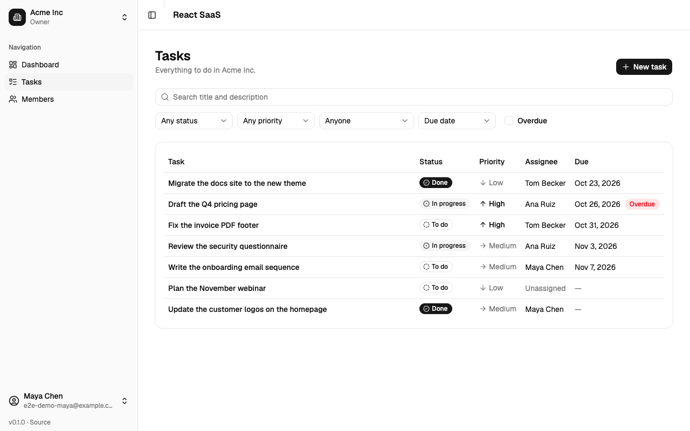
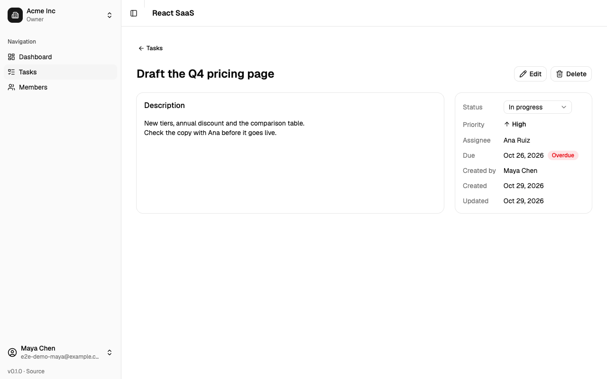
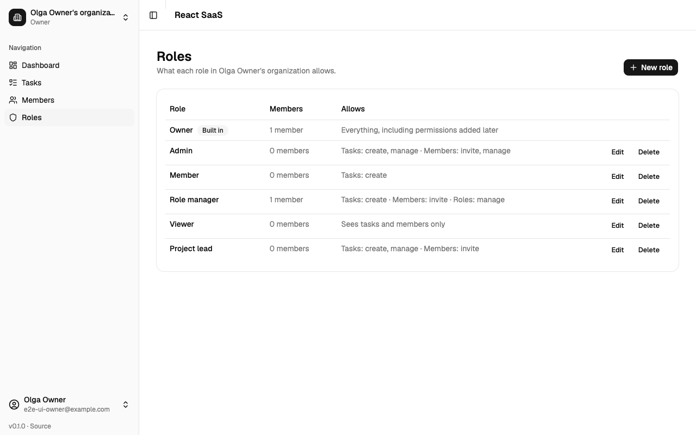
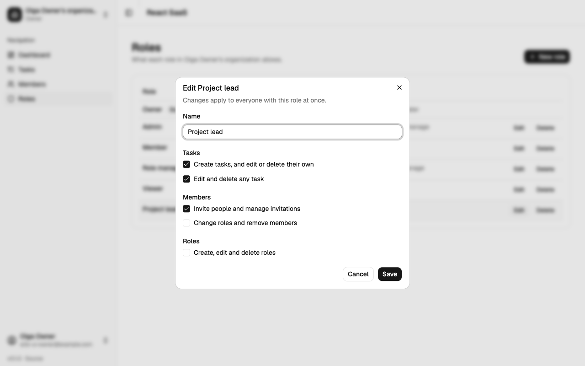
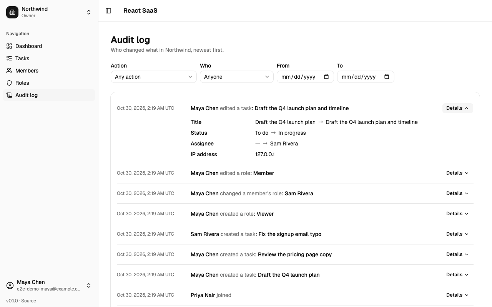
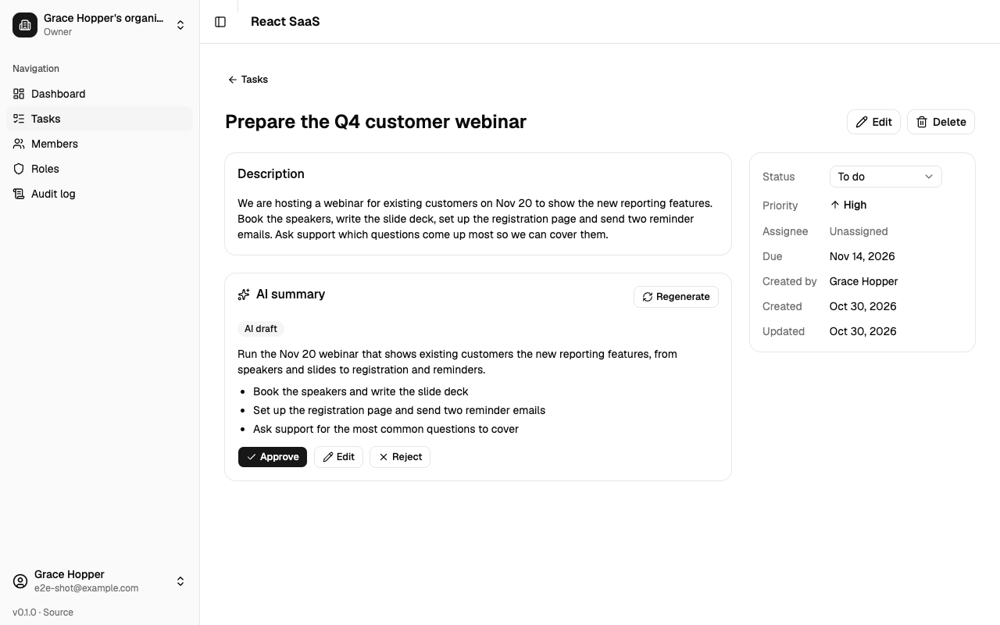
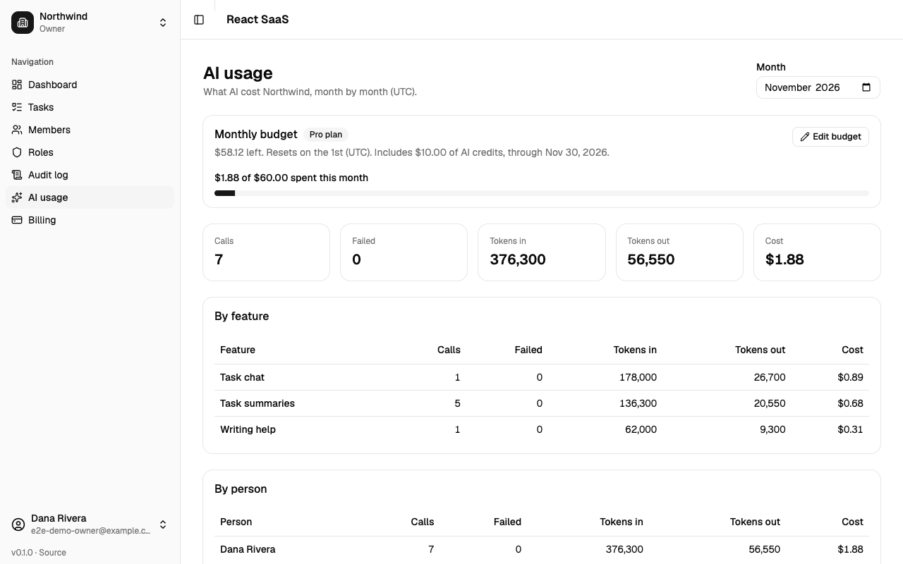
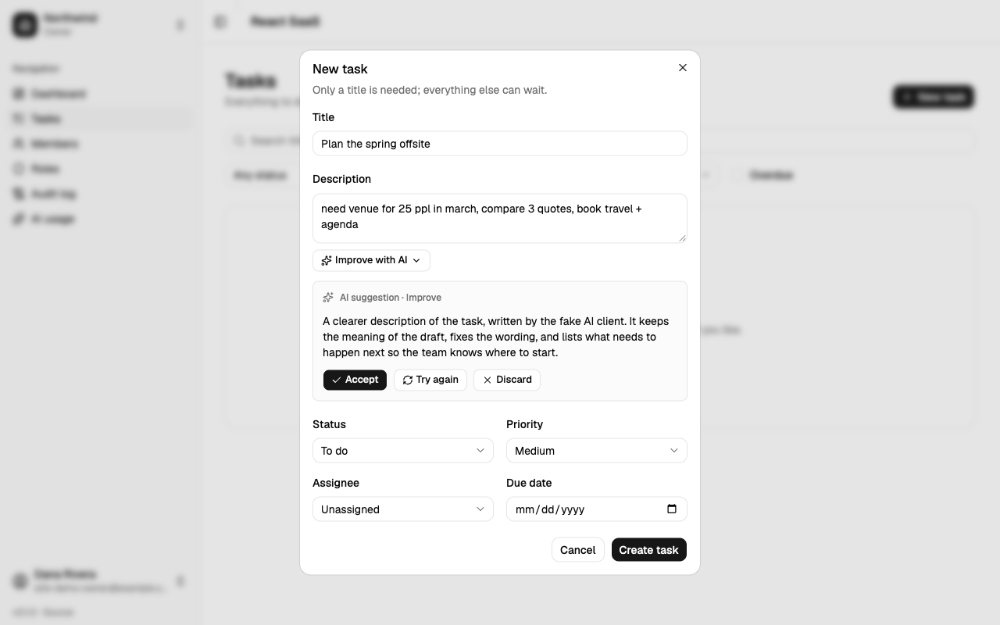
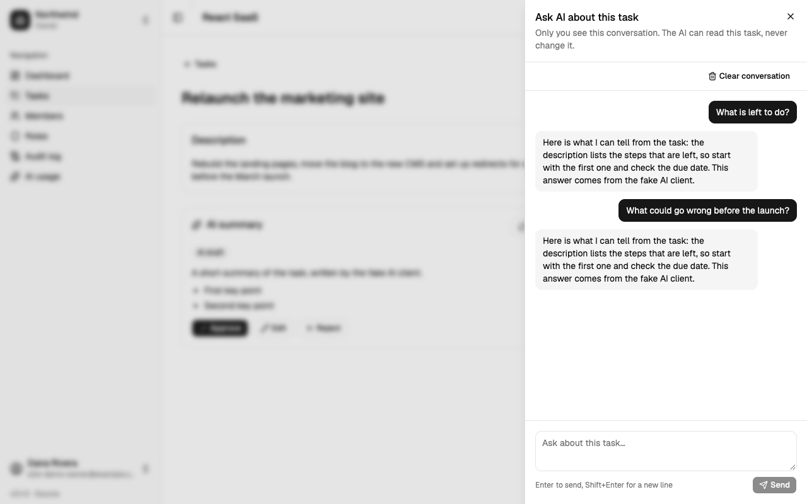
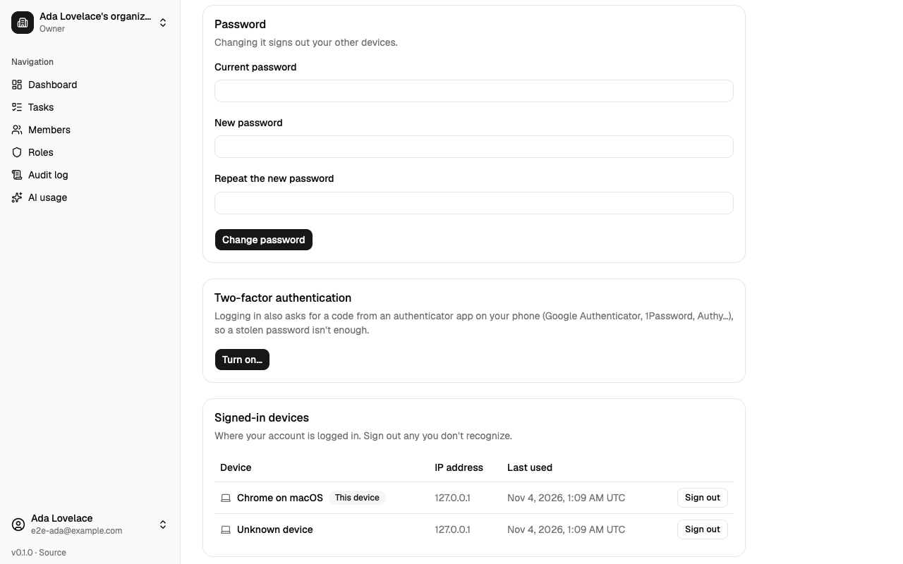

# react-saas

[](https://github.com/dtrinidad-iv/react-saas/actions/workflows/ci.yml)

A multi-organization SaaS starter with a Laravel API and a React app, being rebuilt from [saas-starter](../saas-starter) (Laravel + Nuxt) one feature at a time, as a way to learn React. Tasks take the place of Projects.

## Stack
- **API (`api/`):** Laravel, PostgreSQL, Sanctum token auth, Pest
- **Web (`web/`):** Vite, React 19, TypeScript, React Router, TanStack Query, Zustand, shadcn/ui + Tailwind, react-hook-form + zod, Vitest

## Status
You can register (which creates your own organization and sends a link to verify your email), log in, create more organizations and switch between them from the sidebar, and choose which one to work in after logging in when you're in several. On the Members page, owners and admins invite people by email (an invitation link works with or without an account), change roles and remove members; anyone can leave. On the Tasks page, everyone creates and tracks tasks with a status, priority, due date and an assignee from the organization, and filters them by status, priority, assignee, overdue and search (filters live in the URL, so a filtered list can be shared or reloaded); members edit the tasks they created or are assigned to, owners and admins edit any. On the Roles page, each organization defines its own roles (say, a read-only Viewer) from a list of permissions, next to the built-in Owner and the default Admin and Member; nobody can grant more than they have. The Audit log page shows owners and admins who changed what (tasks, members, invitations, roles) with old → new values, filtered by action, person and dates. Each task with a description gets an AI summary (once your email is verified) (Claude, queued in the background) with a few key points: it stays a draft until someone who can edit the task approves it, edits it first or rejects it, and it says when the task has changed since. Asking for summaries needs the "Ask for AI summaries" permission (Admin and Member have it). In the task form, "Improve with AI" rewrites the description (improve, expand or shorten) and streams the suggestion as it's written; you accept it into the field, try again or discard it. On a task, **Ask AI** opens a private chat about that task (only you see your conversation); answers stream in, and you can stop one or clear the conversation. Each organization has a monthly AI budget (a default the owner can raise, lower, or set to $0 to turn AI off); once it's spent, AI requests are refused until the next month. The AI usage page shows owners and admins one month of calls, tokens and cost by feature, person and day, with the budget. Forgot your password? A reset link by email logs you back in. Account settings (from your name in the sidebar) change your name, email and password, list your signed-in devices so you can sign any of them out, and delete your account. The current organization is kept on the server, and every organization's data is walled off from the others. The roadmap is in [docs/plans](docs/plans/README.md).

## Requirements
PHP 8.4+, Composer, PostgreSQL, Node 22 (`web/.nvmrc`; with nvm: `nvm use` in `web/`).

## Setup

### 1. Databases
Create two databases: one for the app, and one for the tests (the tests wipe theirs). Commands that wipe a database (`migrate:fresh`, `db:wipe`, ...) refuse to run unless its name ends in `_test`, so the app database can't be lost by accident.
```bash
createdb -h 127.0.0.1 -U postgres react_saas
createdb -h 127.0.0.1 -U postgres react_saas_test
```
(Or `CREATE DATABASE ...` from any Postgres client, if `createdb` isn't on your PATH.)

### 2. API
```bash
cd api
composer install
cp .env.example .env        # then set DB_* to match your Postgres
php artisan key:generate
php artisan migrate
```
Key settings in `api/.env`:

| Key | Default | What it's for |
|---|---|---|
| `DB_DATABASE`, `DB_USERNAME`, `DB_PASSWORD` | `react_saas`, `postgres`, empty | The app database |
| `FRONTEND_URL` | `http://localhost:5173` | The only origin CORS allows, and the base of email links |
| `MAIL_MAILER` | `log` | Locally, emails are written to `storage/logs/laravel.log` |
| `AUDIT_RETENTION_DAYS` | `365` | Days to keep audit log entries; `0` keeps them forever |
| `AI_PROVIDER` | `anthropic` | `fake` for canned AI answers with no key and no cost (local work, e2e); `anthropic` calls Claude |
| `ANTHROPIC_API_KEY` | empty | Needed with `AI_PROVIDER=anthropic`; stays on the server |
| `AI_MODEL` | `claude-haiku-5-5` | The model for AI summaries |
| `AI_RATE_LIMIT_PER_MINUTE` | `5` | AI requests per organization per minute |
| `AI_STREAM_TIMEOUT` | `120` | Seconds a streamed AI answer (writing help) may take |
| `AI_MAX_CONCURRENT_STREAMS` | `3` | Streamed AI answers running at once on the server; keep it below the PHP workers (4) |
| `AI_FAKE_STREAM_DELAY_MS` | `0` | With `AI_PROVIDER=fake`, milliseconds between streamed words (e2e runs use 60) |
| `AI_MONTHLY_BUDGET_USD` | `5` | Each organization's monthly AI budget in USD, unless it set its own; `0` turns AI off |

The rest is explained by comments in `api/.env.example`.

### 3. Web
```bash
cd web
npm install
cp .env.example .env        # VITE_API_BASE, if the API isn't on http://localhost:8100
```

## Run
In two terminals:
```bash
cd api && PHP_CLI_SERVER_WORKERS=4 php artisan serve --port=8100 --no-reload
cd web && npm run dev
```
Emails (verification links, invitations) and AI summaries are queued. To have them sent and generated, also run a queue worker: `cd api && php artisan queue:work`. With `MAIL_MAILER=log` they're written to `api/storage/logs/laravel.log`, links included.
Every AI call is recorded in the `ai_usage` table (tokens and cost). To summarize tasks created before AI was set up: `php artisan ai:summarize-tasks` (`--organization=ID`, `--limit=50`, `--dry-run`); the worker then generates them.
Daily cleanup (expired invitations, audit log entries past `AUDIT_RETENTION_DAYS`) runs from the Laravel scheduler: `cd api && php artisan schedule:work` locally, or a cron entry for `php artisan schedule:run` in production.
Open http://localhost:5173 and create an account. Vite must stay on :5173, the only origin the API's CORS allows (`FRONTEND_URL`).

The API answers on `http://localhost:8100/api`:

| Endpoint | What it does |
|---|---|
| `POST /api/register` | Create an account (`name`, `email`, `password`, `password_confirmation`); returns `{user, token}` |
| `POST /api/login` | `email`, `password`; returns `{user, token}` |
| `POST /api/logout` | Revokes the token it's called with |
| `POST /api/forgot-password` | `email`; always the same answer, and emails a reset link if an account uses it (6 a minute per IP, one link a minute per address) |
| `POST /api/reset-password` | `token`, `email`, `password`, `password_confirmation` from the link; signs out every device, verifies the email, and returns `{user, token}` |
| `PATCH /api/account` | Your `name` |
| `PUT /api/account/email` | `email`, `current_password`: asks for the change (10 a day). Nothing changes until the link mailed to the new address is followed; the current one gets a notice. `pending_email` shows on the user |
| `POST /api/account/email/revert/{id}/{old}/{new}` | The undo link from the "email was changed" notice (7 days, no login): the old address comes back, every device is signed out, and it gets a password reset link |
| `POST /api/account/email/confirm/{id}/{hash}` | The link from that email, posted by `/confirm-email` while logged in: the new address becomes the email (verified), and other devices are signed out. `DELETE /api/account/email/pending` cancels the request |
| `PUT /api/account/password` | `current_password`, `password`, `password_confirmation`; other devices are signed out |
| `DELETE /api/account` | `password`. Refused (422) while you're the last owner of an organization with other members; organizations where you're alone are deleted with their data, and you leave the others |
| `GET /api/account/devices` | Your signed-in devices (`name`, `ip_address`, `last_used_at`, `is_current`); `DELETE /api/account/devices/{id}` signs one out |
| `GET /api/me` | The current user, with `current_organization` (and your role in it) |
| `GET /api/organizations` | Your organizations with your role, and `meta.current_organization_id` |
| `POST /api/organizations` | Create one (`name`); you're its owner and it becomes current. 20 a minute |
| `POST /api/organizations/{id}/switch` | Make one of yours current (404 if you're not a member) |
| `POST /api/email/verify/{id}/{hash}` | The signed link from the verification email (the app posts it); `POST /api/email/verification-notification` sends a new one |
| `GET /api/members` | Members of the current organization, with what you may do to each (`can`, `assignable_roles`) |
| `PATCH /api/members/{id}` | Change a role (`role_id`: one of the organization's roles) |
| `DELETE /api/members/{id}` | Remove someone, or leave (your own id) |
| `GET /api/invitations` | Pending invitations of the current organization |
| `POST /api/invitations` | Invite (`email`, `role_id`); needs a verified email. Emails a 7-day link to `/join/{token}` |
| `DELETE /api/invitations/{id}` | Revoke |
| `GET /api/join/{token}` / `POST /api/join/{token}` | See and accept an invitation (logged in as the invited address) |
| `GET /api/tasks` | Tasks of the current organization, 20 a page. Filters: `status`, `priority`, `assignee` (an id, `me` or `none`), `overdue=1`, `search`; `sort` = `newest`, `due` or `priority`; `page` |
| `POST /api/tasks` | Create (`title`, and optionally `description`, `status`, `priority`, `due_date` as `YYYY-MM-DD`, `assignee_id`: a member) |
| `GET /api/tasks/{id}` | One task, with what you may do (`can`) and `is_overdue` |
| `PATCH /api/tasks/{id}` | Change any of the fields above |
| `DELETE /api/tasks/{id}` | Delete |
| `GET /api/tasks/{id}/summary` | The task's AI summary: `data` (the latest, any status: `pending`, `draft`, `approved`, `rejected`, `failed`), `approved` (the one shown until a newer one is approved) and `can.regenerate` |
| `POST /api/tasks/{id}/summary` | Ask for a new one (202, pending; or the one already pending). For whoever may edit the task and has `ai.use`, with a verified email; 5 a minute per organization; 402 `ai_budget_exceeded` once the monthly budget is spent |
| `POST /api/tasks/writing-help` | AI writing help for the New task form (`mode`: `improve`, `expand`, `shorten`; `title`, `description`), answered as server-sent events (`delta`, `done`, `error`). Needs `ai.use` and `tasks.create`, a verified email; 402 over budget, 429 over the rate limit or with too many answers already streaming (2 per organization, 2 per person, 3 on the server). `/api/tasks/{id}/writing-help` does the same for a task you may edit |
| `GET /api/tasks/{id}/chat` | Your last 50 messages about the task, oldest first (`role`, `content`, `status`: `complete`, `stopped`, `failed`). Needs `ai.use`; only ever your own |
| `POST /api/tasks/{id}/chat` | Ask a question (`message`, up to 2000 characters); the answer streams back as server-sent events and is saved. Verified email, `throttle:ai`, budget (402) and stream limits (429), as for writing help |
| `DELETE /api/tasks/{id}/chat` | Clear your conversation about the task (204); other people's stay |
| `POST /api/tasks/{id}/summaries/{summaryId}/approve` | Approve a draft, optionally edited (`summary`, `key_points`); `.../reject` rejects it. 409 unless it's a draft |
| `GET /api/roles` | The organization's roles (Owner first) with their permissions, member counts and what you may do (`can`) |
| `POST /api/roles` | Create (`name`, `permissions`: a list from the catalogue); needs `roles.manage`, and only permissions you have |
| `PATCH /api/roles/{id}` | Rename or change permissions (the whole list); only roles that can do strictly less than yours, never Owner |
| `DELETE /api/roles/{id}` | Delete a role nobody has; its pending invitations stop working |
| `GET /api/permissions` | The permission catalogue (`value`, `label`, `group`) |
| `GET /api/audit-logs` | The organization's audit log, newest first, 25 at a time (`meta.next_cursor`, sent back as `cursor`). Filters: `action`, `actor` (a user id), `from` and `to` (`YYYY-MM-DD`). Needs `audit_log.view`; IP addresses only for owners |
| `GET /api/audit-log/actions` | The action catalogue for the filter (`value`, `label`, `group`) |
| `GET /api/ai-usage` | One month (`month=YYYY-MM`, default this one, UTC) of AI usage: `totals`, `by_feature`, `by_user`, `by_day` (calls, failed, tokens, cost), this month's `budget` and `can.manage_budget`. Needs `ai_usage.view` |
| `PUT /api/ai-budget` | Set the monthly AI budget (`monthly_budget_usd`: 0–10,000, cents at most; `null` = the default). Needs `ai_budget.manage` (Owner) and a verified email; 20 a minute |

Organization-scoped routes (members, invitations, tasks, roles, audit log, AI usage) act on your current organization: there's never an organization id in the URL.

Send the token as `Authorization: Bearer <token>`, with `Accept: application/json`. Register allows 6 attempts a minute per IP; login 6 a minute per email and IP, and 30 per email.

## Tests
```bash
cd api && php artisan test     # Pest, on react_saas_test (rebuilt on every run)
cd api && vendor/bin/pint --test   # PHP code style (vendor/bin/pint to fix)
cd web && npm test             # Vitest + Testing Library, API calls mocked
```
`npm run lint`, `npm run typecheck` and `npm run build` check the rest of the web app.

GitHub Actions runs all of these on every push to `main` and every pull request (`.github/workflows/ci.yml`). To stop a red run from being merged, require the `API (Pint, Pest)` and `Web (lint, typecheck, test, build)` checks under Settings → Branches → branch protection for `main`.

## Screenshots
| | |
|---|---|
|  |  |
| **Log in** | **Register**, with errors from the form and the API on their fields |
|  |  |
| **Dashboard**, with the sidebar: current organization and your role | **Organization switcher**: your organizations, and create one |
|  |  |
| **Choose an organization**, after logging in when you're in several | **Members**: roles, invite by email, pending invitations |
|  |  |
| **Invitation link**: accept to join | **Verify your email** banner, with Resend |
|  |  |
| **Tasks**: filter by status, priority, assignee and overdue, search and sort (all in the URL) | **A task**: change its status in place, edit or delete it per your permissions |
|  |  |
| **Roles**: what each role allows, and how many have it | **Edit a role**: permissions grouped by area |
|  |  |
| **Audit log**: who changed what, with old → new values; filter by action, person and dates | **AI summary** of a task: a draft to approve, edit or reject |
|  |  |
| **AI usage**: the month's budget, and calls and cost by feature, person and day | **AI writing help** in the task form: a streamed suggestion to accept, try again or discard |
|  |  |
| **Ask AI**: a private chat about a task, answers streamed | **Account settings**: name, email, password, signed-in devices, delete account |

## Working with Claude Code
The repo ships its Claude Code setup in `.claude/` and `.mcp.json`: skills for planning, verifying, e2e checks and shipping, reviewer subagents, and hooks that block destructive database commands. [CLAUDE.md](CLAUDE.md) has the conventions.
