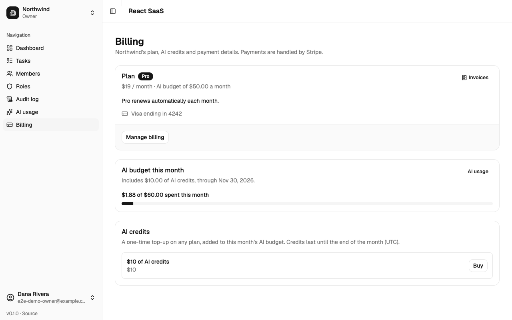
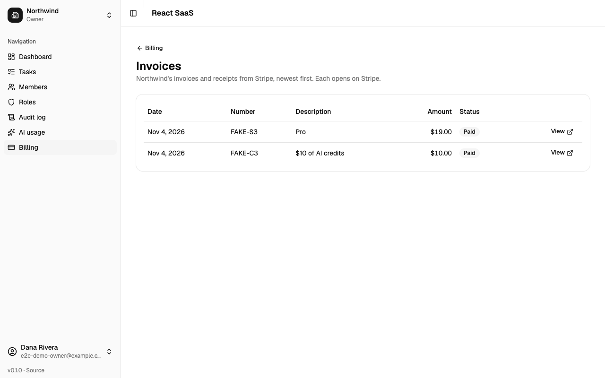
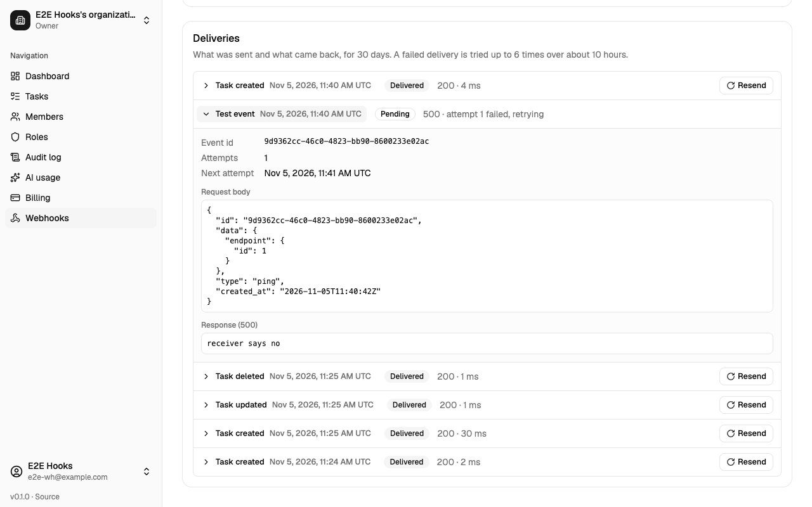
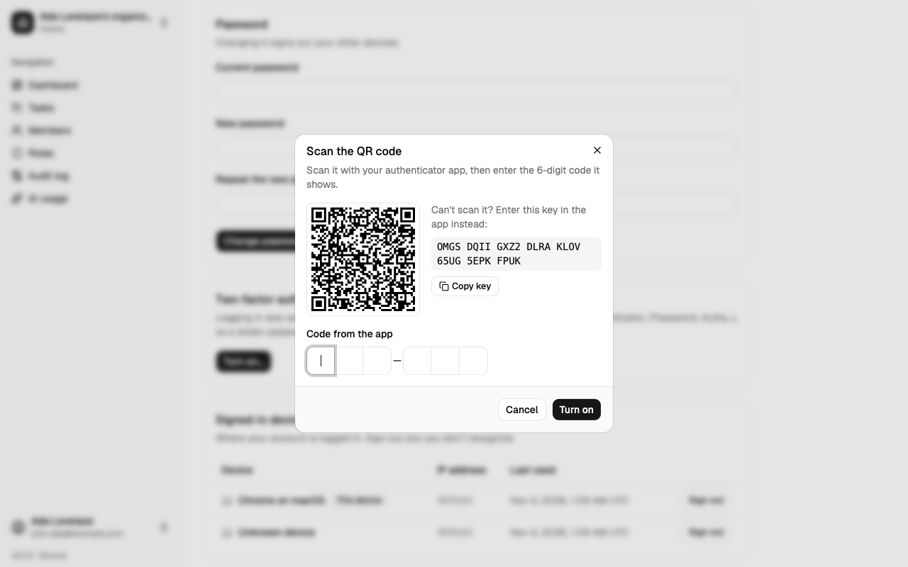
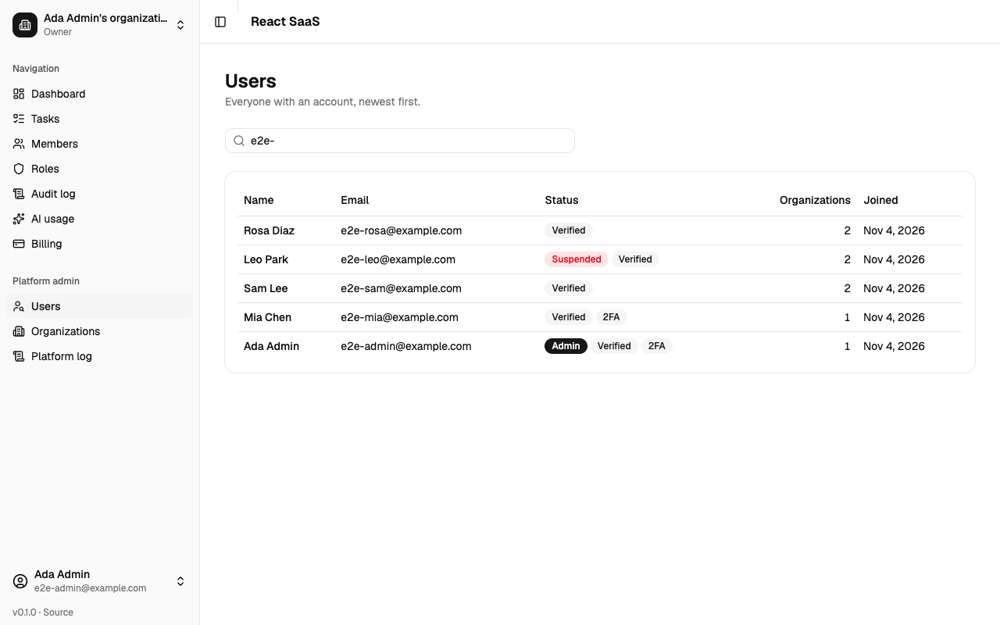
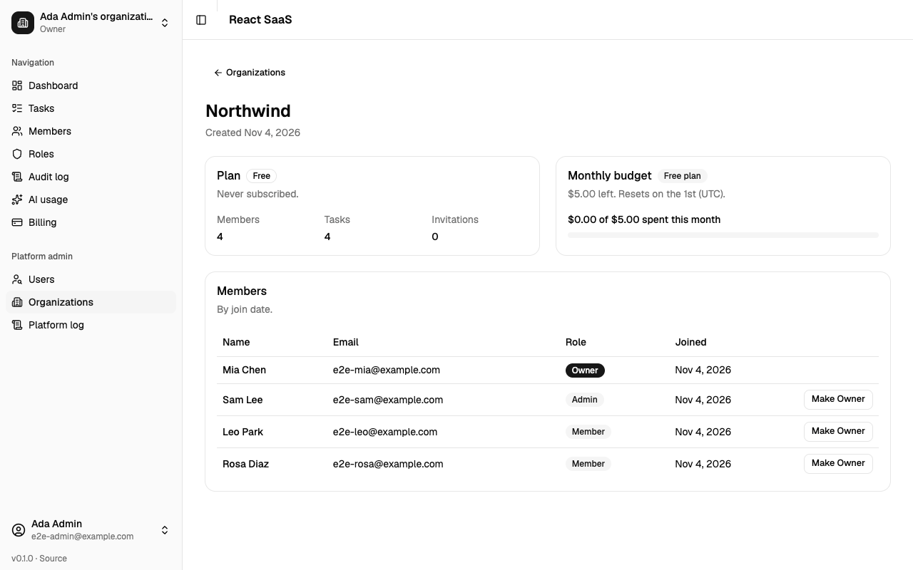
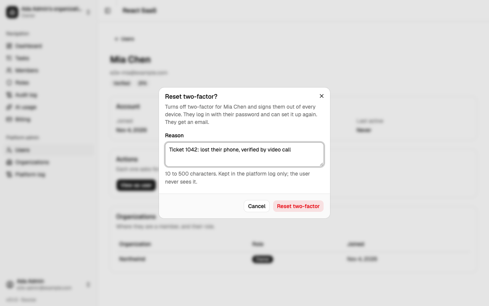
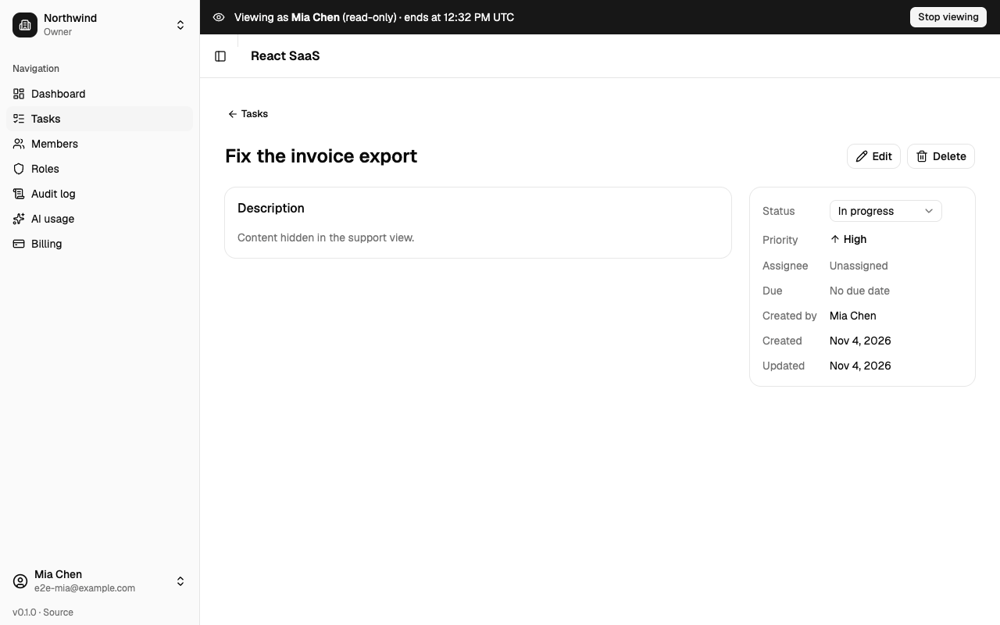

# react-saas

[](https://github.com/dtrinidad-iv/react-saas/actions/workflows/ci.yml)

**A ready-made foundation for a team software product (SaaS).** Companies sign up, invite their people, and work together on tasks, with AI help built in. Accounts, teams, permissions, payments, security and an admin area are already done, so a new product can start from here and spend its time on what makes it different.

**Contents:** [At a glance](#at-a-glance) · [What it does](#what-it-does) · [Who can do what](#who-can-do-what) · [Security and privacy](#security-and-privacy) · [How it's built](#how-its-built) · [Setup](#setup-for-developers) · [Tests](#tests)

## At a glance
- **Teams (organizations).** Each customer company is its own organization, with its own members, data and bill. One person can belong to several, like Slack workspaces, and switch between them.
- **Tasks.** The example feature: create, assign, prioritize, filter and track work.
- **AI help.** Summaries of tasks, help writing them, and a private chat about any task. Each organization has a monthly AI spending limit.
- **Roles and permissions.** Owner, Admin and Member come built in, and each organization can create its own roles, such as a read-only Viewer.
- **Payments.** A Free and a Pro plan, extra AI credits, card management and invoices, all handled by Stripe.
- **Security.** Email verification, two-factor login, an audit log of who changed what, and data kept strictly separate between organizations.
- **Webhooks.** Connect other tools: the app tells your CRM, chat or own system the moment a task changes.
- **Platform admin.** The people running the product can look up users and organizations, help them, and see the app as a user sees it (read-only).

## What it does

### Sign up and log in
- Anyone can create an account. They get their own organization straight away and an email to confirm their address.
- Forgot your password? A reset link arrives by email.
- People who belong to several organizations choose one after logging in.

| | |
|---|---|
|  |  |
| **Log in** | **Register**: mistakes are shown next to the field they concern |
|  |  |
| **Choose an organization** after logging in | **Verify your email** reminder, with a button to resend it |

### Organizations and members
- Create more organizations and switch between them from the sidebar.
- Owners and admins invite people by email. The invitation link works whether or not the person already has an account, and expires after 7 days.
- Owners and admins change a member's role or remove them. Anyone can leave.
- An organization can never be left without an owner.

| | |
|---|---|
|  |  |
| **Dashboard**, with the sidebar showing the current organization and your role | **Organization switcher**: your organizations, and a button to create one |
|  |  |
| **Members**: roles, invitations by email, pending invitations | **Invitation link**: one click to join |

### Tasks
- Every task has a title, description, status (To do, In progress, Done), priority, due date and an assignee from the organization.
- Filter the list by status, priority, assignee, overdue or a search word, and sort it. Filters live in the page address, so a filtered list can be bookmarked or shared.
- Overdue tasks are flagged automatically.
- Members edit the tasks they created or are assigned to. Owners and admins edit any task.

| | |
|---|---|
|  |  |
| **Tasks**: filters, search and sorting | **A task**: change its status in place, edit or delete it |

### AI features
Powered by Claude (Anthropic). AI only ever reads one task at a time, never another organization's data, and never changes anything on its own.
- **Summaries.** A task with a description gets a short AI summary with key points. It stays a draft until someone approves it, edits it or rejects it, and it says when the task has changed since.
- **Writing help.** "Improve with AI" in the task form rewrites the description (improve, expand or shorten). The suggestion appears word by word, and you accept it, try again or discard it.
- **Ask AI.** A private chat about a task. Only you see your own conversation, not even the owner can read it. You can stop an answer or clear the chat.
- **Spending limit.** Each organization has a monthly AI budget set by its plan. The owner can lower it, or set it to $0 to turn AI off. Once it's spent, AI waits until next month (or until credits are bought).
- **AI usage page.** Shows owners and admins the month's AI calls and cost by feature, person and day.

| | |
|---|---|
|  |  |
| **AI summary**: a draft to approve, edit or reject | **AI writing help** in the task form |
|  |  |
| **Ask AI**: a private chat about a task | **AI usage**: the budget, and calls and cost by feature, person and day |

### Billing
Payments run entirely on Stripe's own secure pages. The app never sees card numbers.
- **Plans:** Free, or **Pro**, which raises the monthly AI budget.
- **AI credits:** one-time packs that add to this month's AI budget.
- **Manage billing:** change the card or cancel in Stripe's customer portal.
- **Invoices:** listed in the app, each opening Stripe's copy (with a PDF).
- Only the owner manages billing (or a custom role given that permission).

| | |
|---|---|
|  |  |
| **Billing**: the plan, the card, the AI budget, and credits to buy | **Invoices** from Stripe |

### Roles and the audit log
- **Roles.** Each organization can make its own roles from a list of permissions (for example a "Viewer" who can only read). Nobody can give out more than they have themselves, so an admin can never make themselves an owner.
- **Audit log.** Owners and admins see who did what and when: tasks, members, invitations, roles, billing. Changes show old → new values. Filter by action, person and dates. Entries can't be edited, and are kept for a year by default.

| | |
|---|---|
|  |  |
| **Roles**: what each role allows, and how many people have it | **Edit a role**: permissions grouped by area |
|  | |
| **Audit log**: who changed what, with old → new values | |

### Webhooks (connecting other tools)
A webhook tells another system about changes the moment they happen. For example, a new task appears in your CRM, or a message goes to your team chat when a task is done.
- The owner adds the web address (URL) of the other system and picks which events to send: task created, updated or deleted.
- Every message is **signed** with a secret key that only you and the receiving system know, so it can tell the message really came from this app.
- A **delivery log** shows each message: what was sent, what the other system answered, and whether it worked. Any message can be sent again with one click, and a test message checks the connection.
- If the other system is down, the app tries again up to 6 times over about 10 hours. After many failures in a row it pauses that webhook and says why on the page.
- Only the owner manages webhooks (or a custom role given that permission), since they send task content outside the app. They can only point at public internet addresses, never at the app's own private network.

| |
|---|
|  |
| **A webhook's delivery log**: each message with what was sent and what came back, retries, and Resend |

### Your account
From your name at the bottom of the sidebar:
- Change your name, email or password. A new email address only takes effect once you confirm it from that inbox, and the old address gets a 7-day "undo" link in case someone else made the change.
- See every device you're signed in on, and sign any of them out.
- **Two-factor login:** after your password, also enter a code from an authenticator app (Google Authenticator, 1Password, ...). You get one-time recovery codes in case you lose your phone.
- Delete your account. Organizations where you're the only member are deleted with it. It's refused while other people still depend on you as the last owner.

| | |
|---|---|
|  |  |
| **Account settings** | **Two-factor setup**: scan the QR code, then enter a code |

### Platform admin (for the team running the product)
Not an organization role: only granted from the server's command line, and only to people with two-factor login turned on. Admins:
- search all users and organizations (plan, AI budget, member counts; never task content or chats);
- help a user: reset their two-factor login, sign them out everywhere, or suspend and unsuspend them;
- make a member Owner of an organization whose owners are gone;
- **view the app as a user**, read-only and for 30 minutes, to see exactly what they see. Private content stays hidden.

Every admin action needs a written reason and a fresh two-factor code, is recorded in a platform log, and the user is emailed. The organization's own audit log shows "Platform admin".

| | |
|---|---|
|  |  |
| **Users**: search everyone | **An organization**: plan, AI budget, counts and members |
|  |  |
| **Actions** on a user, each with a reason | **View as user**: read-only, with private content hidden |

## Who can do what
The three roles every organization starts with. Owners can change Admin and Member, or add their own roles.

| | Owner | Admin | Member |
|---|:---:|:---:|:---:|
| See all tasks | ✓ | ✓ | ✓ |
| Create tasks, edit their own and those assigned to them | ✓ | ✓ | ✓ |
| Edit and delete anyone's tasks | ✓ | ✓ | |
| Use AI (summaries, writing help, chat) | ✓ | ✓ | ✓ |
| Invite people, change roles, remove members | ✓ | ✓ | |
| See the audit log | ✓ | ✓ | |
| See AI usage and cost | ✓ | ✓ | |
| Create and edit roles | ✓ | | |
| Change the AI budget | ✓ | | |
| Manage the plan, card and invoices | ✓ | | |
| Manage webhooks | ✓ | | |

Owners can do everything. An admin can't change or remove an owner.

## Security and privacy
- **Each organization's data is walled off.** Users never pick which organization's data they see: the server decides from who they are, on every request. Automated tests check this for every feature.
- **Logins are protected:** limits on attempts, optional two-factor login, emails for every important account change, with undo links, and "sign out everywhere".
- **Payments never touch the app:** cards are entered on Stripe's pages only.
- **AI keys stay on the server.** AI output is always a suggestion a person approves.
- **Everything important is recorded:** the audit log for each organization, and a separate log of platform admin actions.
- **Private stays private:** task chats are visible only to their author, and even a platform admin viewing as a user can't read task content.

## How it's built
- **Server (`api/`):** Laravel (PHP) with a PostgreSQL database, Stripe through Laravel Cashier, Claude for AI. Tested with Pest.
- **Web app (`web/`):** React 19 with TypeScript, styled with Tailwind and shadcn/ui. Tested with Vitest.
- Every change runs the full test suite automatically on GitHub (the CI badge above).
- Built one feature at a time from written plans ([docs/plans](docs/plans/README.md)). It's a React rebuild of the earlier [saas-starter](../saas-starter) (Laravel + Nuxt), with Tasks in place of Projects.
- For developers: the [API reference](docs/api.md) lists every endpoint, and [CLAUDE.md](CLAUDE.md) has the code conventions.

# Setup (for developers)

## Requirements
PHP 8.4+, Composer, PostgreSQL, Node 22 (`web/.nvmrc`; with nvm: `nvm use` in `web/`).


### 1. Databases
Create two databases: one for the app, and one for the tests (the tests wipe theirs). Commands that wipe a database (`migrate:fresh`, `db:wipe`, ...) refuse to run unless its name ends in `_test`, so the app database can't be lost by accident.
```bash
createdb -h 127.0.0.1 -U postgres react_saas
createdb -h 127.0.0.1 -U postgres react_saas_test
```
(Or `CREATE DATABASE ...` from any Postgres client, if `createdb` isn't on your PATH.)

### 2. API
```bash
cd api
composer install
cp .env.example .env        # then set DB_* to match your Postgres
php artisan key:generate
php artisan migrate
```
Key settings in `api/.env`:

| Key | Default | What it's for |
|---|---|---|
| `DB_DATABASE`, `DB_USERNAME`, `DB_PASSWORD` | `react_saas`, `postgres`, empty | The app database |
| `FRONTEND_URL` | `http://localhost:5173` | The only origin CORS allows, and the base of email links |
| `MAIL_MAILER` | `log` | Locally, emails are written to `storage/logs/laravel.log` |
| `AUDIT_RETENTION_DAYS` | `365` | Days to keep audit log entries; `0` keeps them forever |
| `AI_PROVIDER` | `anthropic` | `fake` for canned AI answers with no key and no cost (local work, e2e); `anthropic` calls Claude |
| `ANTHROPIC_API_KEY` | empty | Needed with `AI_PROVIDER=anthropic`; stays on the server |
| `AI_MODEL` | `claude-haiku-5-5` | The model for AI summaries |
| `AI_RATE_LIMIT_PER_MINUTE` | `5` | AI requests per organization per minute |
| `AI_STREAM_TIMEOUT` | `120` | Seconds a streamed AI answer (writing help) may take |
| `AI_MAX_CONCURRENT_STREAMS` | `3` | Streamed AI answers running at once on the server; keep it below the PHP workers (4) |
| `AI_FAKE_STREAM_DELAY_MS` | `0` | With `AI_PROVIDER=fake`, milliseconds between streamed words (e2e runs use 60) |
| `AI_MONTHLY_BUDGET_USD` | `5` | The Free plan's monthly AI budget in USD per organization (owners can set a lower one); `0` turns AI off |
| `BILLING_PROVIDER` | `stripe` | `fake` for no Stripe calls (e2e; only with `APP_ENV=local` or `testing`) |
| `STRIPE_KEY`, `STRIPE_SECRET`, `STRIPE_WEBHOOK_SECRET` | empty | Stripe API keys and the webhook's signing secret (without it every webhook is refused) |
| `STRIPE_PRICE_PRO`, `STRIPE_PRICE_CREDITS_10` | empty | Stripe price ids of the Pro plan (recurring) and the $10 AI credit pack (one-time); without one, it can't be bought |
| `BILLING_PRO_AI_BUDGET_USD` | `50` | Pro's monthly AI budget in USD |
| `ADMIN_TWO_FACTOR_TTL_MINUTES` | `720` | Platform admin pages need a two-factor code on this device within this many minutes |
| `ADMIN_ACTION_TWO_FACTOR_TTL_MINUTES` | `15` | Platform admin actions (reset two-factor, sign out, suspend, make Owner, view as user) need a fresher one |
| `ADMIN_IMPERSONATION_MINUTES` | `30` | How long a read-only "view as user" session lasts |
| `WEBHOOK_DELIVERY_RETENTION_DAYS` | `30` | Days to keep the webhook delivery log |
| `WEBHOOK_QUEUE`, `WEBHOOK_RATE_LIMIT_PER_MINUTE` | `webhooks`, `60` | The queue deliveries run on, and delivery attempts per organization per minute |
| `WEBHOOKS_ALLOWED_PRIVATE_TARGETS` | empty | `host:port` pairs webhooks may reach on a private network (a local test receiver); only allowed with `APP_ENV=local` or `testing` |

The rest is explained by comments in `api/.env.example`.

#### Platform admins (optional)
Platform admins are made from the command line only, and need two-factor turned on first (Account settings):
```bash
php artisan admin:grant you@example.com    # admin:revoke takes it away
```
They then log in with a code from their authenticator app; the **Platform admin** group shows in the sidebar. Turning two-factor off ends admin until it's granted again.

#### Stripe (optional)
Billing works without Stripe until someone pays: the Billing page shows the Free plan, and Upgrade says the plan isn't available yet. To try it for real in Stripe's test mode:
1. In the Stripe dashboard (test mode), create a product "Pro" with a monthly price, and one "AI credits" with a one-time $10 price. Put their `price_...` ids in `STRIPE_PRICE_PRO` and `STRIPE_PRICE_CREDITS_10`, and the API keys in `STRIPE_KEY` / `STRIPE_SECRET`.
2. Turn on the Customer Portal (Settings → Billing → Customer portal), with plan switching off.
3. Forward webhooks with the Stripe CLI and put the secret it prints in `STRIPE_WEBHOOK_SECRET`:
   ```bash
   stripe listen --forward-to localhost:8100/api/stripe/webhook \
     --events customer.subscription.created,customer.subscription.updated,customer.subscription.deleted,customer.updated,customer.deleted,checkout.session.completed,checkout.session.async_payment_succeeded
   ```
4. Upgrade with the card `4242 4242 4242 4242` (any future date, any CVC). In production, add the same events to a webhook endpoint in the dashboard, and set "If all retries for a payment fail" to cancel the subscription.

### 3. Web
```bash
cd web
npm install
cp .env.example .env        # VITE_API_BASE, if the API isn't on http://localhost:8100
```

## Run
In two terminals:
```bash
cd api && PHP_CLI_SERVER_WORKERS=4 php artisan serve --port=8100 --no-reload
cd web && npm run dev
```
Emails (verification links, invitations) and AI summaries are queued. To have them sent and generated, also run a queue worker: `cd api && php artisan queue:work --queue=default,webhooks`. With `MAIL_MAILER=log` they're written to `api/storage/logs/laravel.log`, links included.
Every AI call is recorded in the `ai_usage` table (tokens and cost). To summarize tasks created before AI was set up: `php artisan ai:summarize-tasks` (`--organization=ID`, `--limit=50`, `--dry-run`); the worker then generates them.
Webhook deliveries are queued on their own `webhooks` queue, so a slow receiver never holds up emails: `php artisan queue:work --queue=default,webhooks` runs both (or give `webhooks` its own worker). Without a worker no webhook is sent; with `QUEUE_CONNECTION=sync` only the first attempt is.
Daily cleanup (expired invitations, audit log entries past `AUDIT_RETENTION_DAYS`, webhook deliveries past `WEBHOOK_DELIVERY_RETENTION_DAYS`) runs from the Laravel scheduler: `cd api && php artisan schedule:work` locally, or a cron entry for `php artisan schedule:run` in production.
Open http://localhost:5173 and create an account. Vite must stay on :5173, the only origin the API's CORS allows (`FRONTEND_URL`).

The API answers on `http://localhost:8100/api`: every endpoint is listed in the [API reference](docs/api.md).

## Tests
```bash
cd api && php artisan test     # Pest, on react_saas_test (rebuilt on every run)
cd api && vendor/bin/pint --test   # PHP code style (vendor/bin/pint to fix)
cd web && npm test             # Vitest + Testing Library, API calls mocked
```
`npm run lint`, `npm run typecheck` and `npm run build` check the rest of the web app.

GitHub Actions runs all of these on every push to `main` and every pull request (`.github/workflows/ci.yml`). To stop a red run from being merged, require the `API (Pint, Pest)` and `Web (lint, typecheck, test, build)` checks under Settings → Branches → branch protection for `main`.

## Working with Claude Code
The repo ships its Claude Code setup in `.claude/` and `.mcp.json`: skills for planning, verifying, e2e checks and shipping, reviewer subagents, and hooks that block destructive database commands. [CLAUDE.md](CLAUDE.md) has the conventions.
