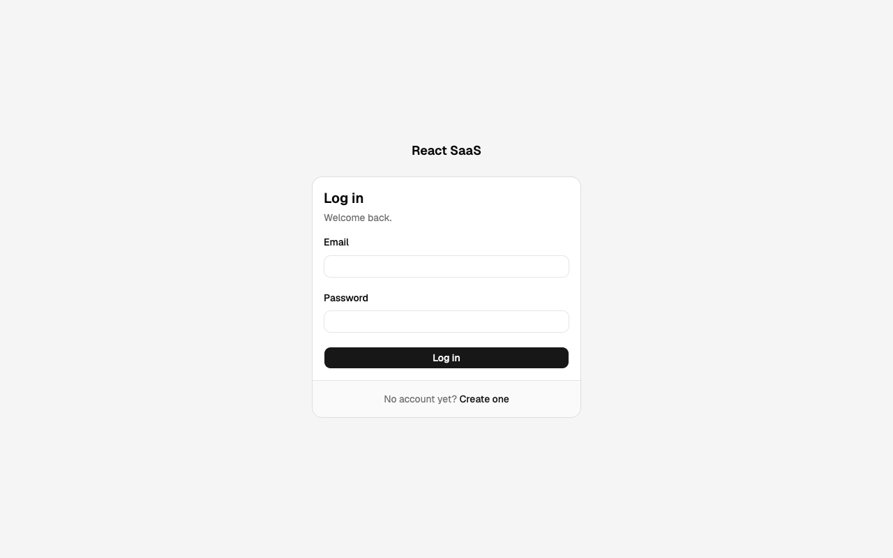
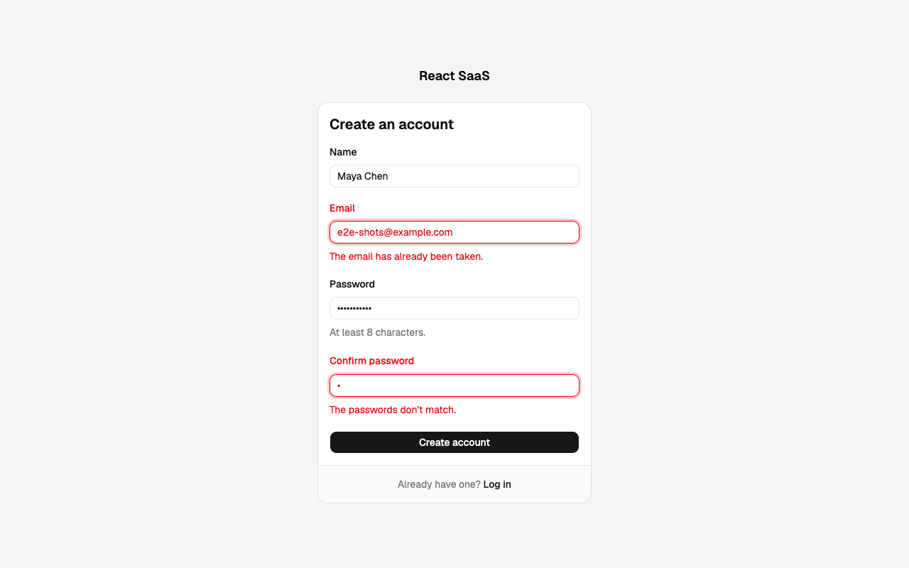
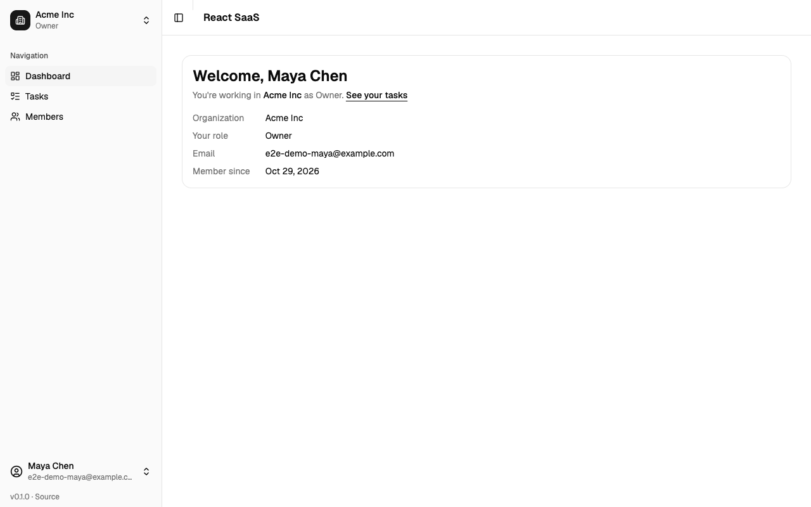
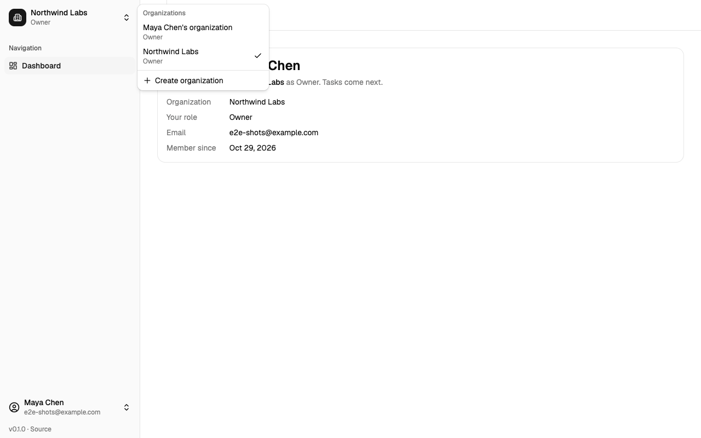
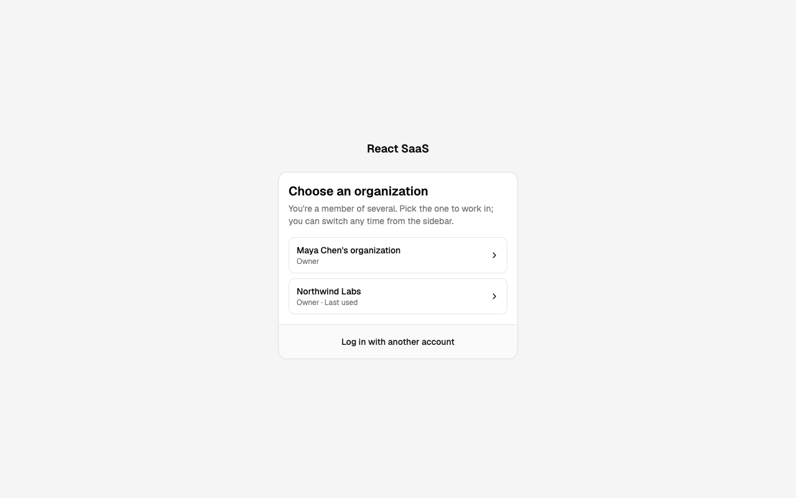
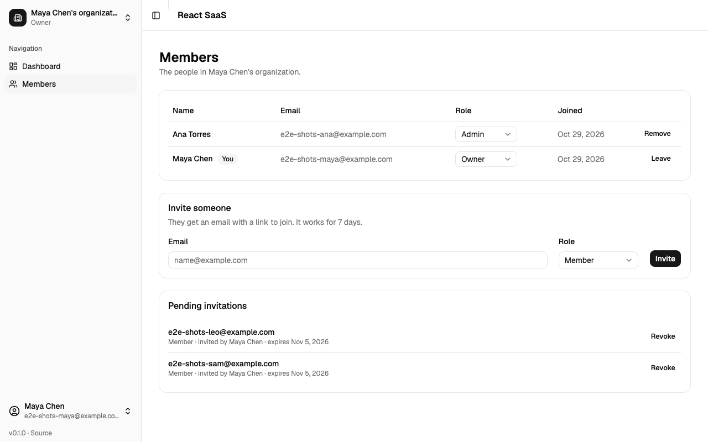
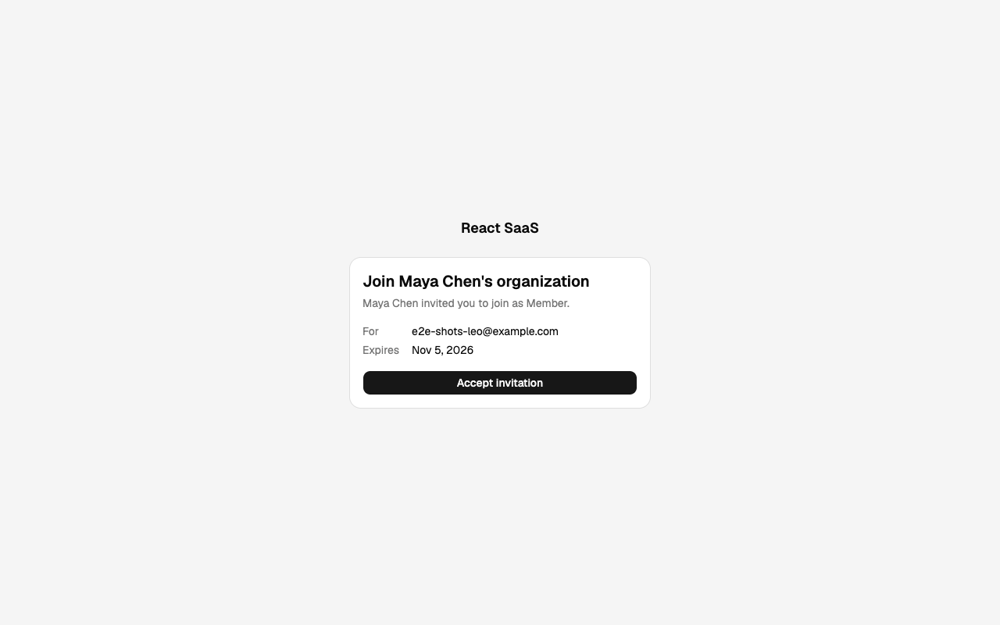
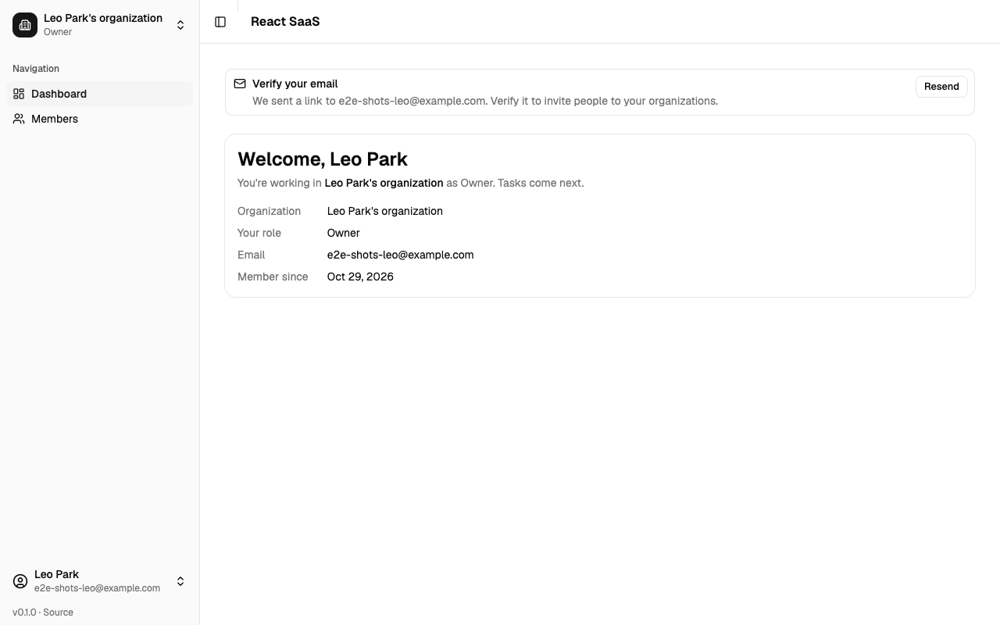

# react-saas

[](https://github.com/dtrinidad-iv/react-saas/actions/workflows/ci.yml)

A multi-organization SaaS starter with a Laravel API and a React app, being rebuilt from [saas-starter](../saas-starter) (Laravel + Nuxt) one feature at a time, as a way to learn React. Tasks take the place of Projects.

## Stack
- **API (`api/`):** Laravel, PostgreSQL, Sanctum token auth, Pest
- **Web (`web/`):** Vite, React 19, TypeScript, React Router, TanStack Query, Zustand, shadcn/ui + Tailwind, react-hook-form + zod, Vitest

## Status
You can register (which creates your own organization and sends a link to verify your email), log in, create more organizations and switch between them from the sidebar, and choose which one to work in after logging in when you're in several. On the Members page, owners and admins invite people by email (an invitation link works with or without an account), change roles and remove members; anyone can leave. The current organization is kept on the server, and every organization's data is walled off from the others. Tasks come next. The roadmap is in [docs/plans](docs/plans/README.md).

## Requirements
PHP 8.4+, Composer, PostgreSQL, Node 22 (`web/.nvmrc`; with nvm: `nvm use` in `web/`).

## Setup

### 1. Databases
Create two databases: one for the app, and one for the tests (the tests wipe theirs). Commands that wipe a database (`migrate:fresh`, `db:wipe`, ...) refuse to run unless its name ends in `_test`, so the app database can't be lost by accident.
```bash
createdb -h 127.0.0.1 -U postgres react_saas
createdb -h 127.0.0.1 -U postgres react_saas_test
```
(Or `CREATE DATABASE ...` from any Postgres client, if `createdb` isn't on your PATH.)

### 2. API
```bash
cd api
composer install
cp .env.example .env        # then set DB_* to match your Postgres
php artisan key:generate
php artisan migrate
```
Key settings in `api/.env`:

| Key | Default | What it's for |
|---|---|---|
| `DB_DATABASE`, `DB_USERNAME`, `DB_PASSWORD` | `react_saas`, `postgres`, empty | The app database |
| `FRONTEND_URL` | `http://localhost:5173` | The only origin CORS allows, and the base of email links |
| `MAIL_MAILER` | `log` | Locally, emails are written to `storage/logs/laravel.log` |

The rest is explained by comments in `api/.env.example`.

### 3. Web
```bash
cd web
npm install
cp .env.example .env        # VITE_API_BASE, if the API isn't on http://localhost:8100
```

## Run
In two terminals:
```bash
cd api && PHP_CLI_SERVER_WORKERS=4 php artisan serve --port=8100 --no-reload
cd web && npm run dev
```
Emails (verification links, invitations) are queued. To have them sent, also run a queue worker: `cd api && php artisan queue:work`. With `MAIL_MAILER=log` they're written to `api/storage/logs/laravel.log`, links included.
Open http://localhost:5173 and create an account. Vite must stay on :5173, the only origin the API's CORS allows (`FRONTEND_URL`).

The API answers on `http://localhost:8100/api`:

| Endpoint | What it does |
|---|---|
| `POST /api/register` | Create an account (`name`, `email`, `password`, `password_confirmation`); returns `{user, token}` |
| `POST /api/login` | `email`, `password`; returns `{user, token}` |
| `POST /api/logout` | Revokes the token it's called with |
| `GET /api/me` | The current user, with `current_organization` (and your role in it) |
| `GET /api/organizations` | Your organizations with your role, and `meta.current_organization_id` |
| `POST /api/organizations` | Create one (`name`); you're its owner and it becomes current. 20 a minute |
| `POST /api/organizations/{id}/switch` | Make one of yours current (404 if you're not a member) |
| `POST /api/email/verify/{id}/{hash}` | The signed link from the verification email (the app posts it); `POST /api/email/verification-notification` sends a new one |
| `GET /api/members` | Members of the current organization, with what you may do to each (`can`, `assignable_roles`) |
| `PATCH /api/members/{id}` | Change a role (`role`) |
| `DELETE /api/members/{id}` | Remove someone, or leave (your own id) |
| `GET /api/invitations` | Pending invitations of the current organization |
| `POST /api/invitations` | Invite (`email`, `role`); needs a verified email. Emails a 7-day link to `/join/{token}` |
| `DELETE /api/invitations/{id}` | Revoke |
| `GET /api/join/{token}` / `POST /api/join/{token}` | See and accept an invitation (logged in as the invited address) |

Organization-scoped routes (members, invitations) act on your current organization: there's never an organization id in the URL.

Send the token as `Authorization: Bearer <token>`, with `Accept: application/json`. Register allows 6 attempts a minute per IP; login 6 a minute per email and IP, and 30 per email.

## Tests
```bash
cd api && php artisan test     # Pest, on react_saas_test (rebuilt on every run)
cd api && vendor/bin/pint --test   # PHP code style (vendor/bin/pint to fix)
cd web && npm test             # Vitest + Testing Library, API calls mocked
```
`npm run lint`, `npm run typecheck` and `npm run build` check the rest of the web app.

GitHub Actions runs all of these on every push to `main` and every pull request (`.github/workflows/ci.yml`). To stop a red run from being merged, require the `API (Pint, Pest)` and `Web (lint, typecheck, test, build)` checks under Settings → Branches → branch protection for `main`.

## Screenshots
| | |
|---|---|
|  |  |
| **Log in** | **Register**, with errors from the form and the API on their fields |
|  |  |
| **Dashboard**, with the sidebar: current organization and your role | **Organization switcher**: your organizations, and create one |
|  |  |
| **Choose an organization**, after logging in when you're in several | **Members**: roles, invite by email, pending invitations |
|  |  |
| **Invitation link**: accept to join | **Verify your email** banner, with Resend |

## Working with Claude Code
The repo ships its Claude Code setup in `.claude/` and `.mcp.json`: skills for planning, verifying, e2e checks and shipping, reviewer subagents, and hooks that block destructive database commands. [CLAUDE.md](CLAUDE.md) has the conventions.
